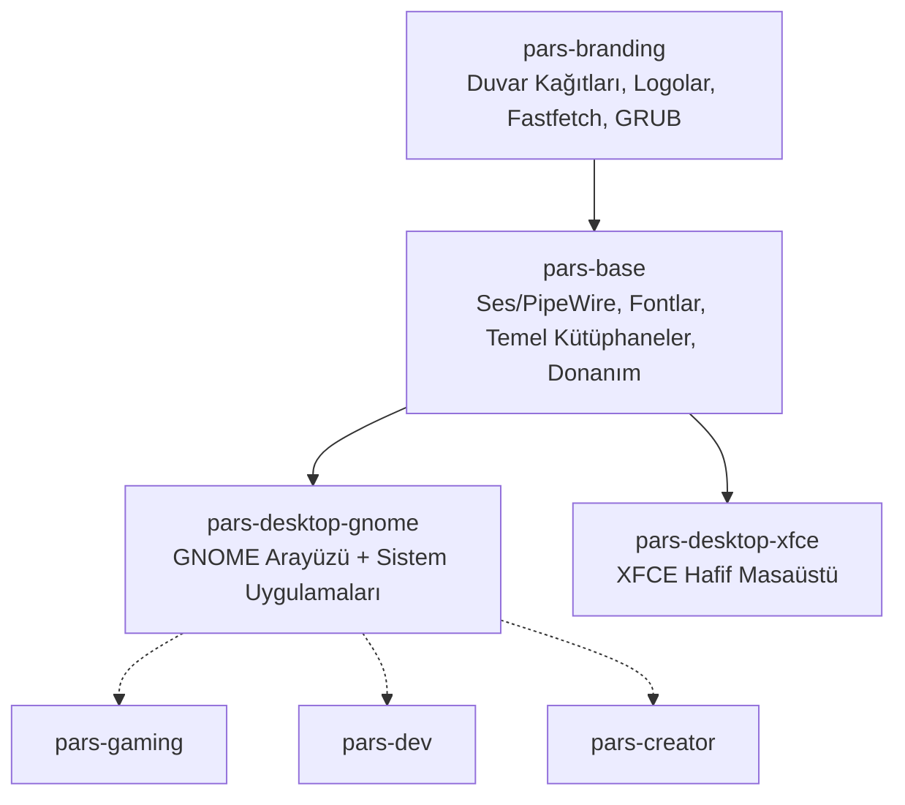

# 🐆 ParsLinux Base (`pars-base`)

**ParsLinux Base**, tüm ParsLinux masaüstü ortamlarının (`pars-desktop-gnome`, `pars-desktop-xfce`) ve sistem rollerinin altında çalışan **temel sistem katmanı (Core Base Layer)** meta paketidir.

Masaüstünden bağımsız olarak her ParsLinux kurulumunda bulunması gereken ses mimarisini, yazı tiplerini, donanım katmanlarını ve görsel kimliği tek çatı altında birleştirir.

---

## 🧱 Katmanlı Mimari İçindeki Yeri



---

## 📦 Paket İçeriği ve Yapılandırmalar

| Kategori | Paketler / Dosyalar | Açıklama |
| :--- | :--- | :--- |
| **Görsel Kimlik** | `pars-branding` | Duvar kağıdı, logolar, tema ayarları ve fastfetch kimliği |
| **Modern Ses** | `pipewire`, `pipewire-pulse`, `wireplumber` | Düşük gecikmeli, PulseAudio ve ALSA uyumlu modern ses sunucusu |
| **Ses Ayarları** | `/etc/pipewire/pipewire.conf.d/99-pars-audio.conf` | 48 kHz ve düşük gecikme optimizasyonları |
| **Ses İzinleri** | `/etc/security/limits.d/99-pars-audio.conf` | Çatlamasız ses için gerçek zamanlı öncelik (`rtprio 95`) |
| **Yazı Tipleri** | `fonts-ubuntu`, `fonts-noto-core`, `fonts-dejavu-core` | Türkçe karakterler için kusursuz glif ve pürüzsüzleştirme |
| **Font Ayarları**| `/etc/fonts/conf.avail/99-pars-fonts.conf` | Subpixel rendering (RGB), antialiasing ve hintslight ayarı |
| **Ağ & Donanım** | `network-manager`, `bluez`, `wireless-tools` | Wi-Fi, Ethernet, Bluetooth bağlantı yönetimi |
| **Sistem Servisi**| `/usr/lib/systemd/user-preset/99-pars-pipewire.preset` | PipeWire servislerinin her kullanıcıda otomatik başlaması |
| **Dosya Sistemleri**| `btrfs-progs`, `xfsprogs`, `dosfstools`, `ntfs-3g` | Modern ve harici disk biçimleri desteği |

---

## 🚀 Hızlı Başlangıç & Kullanım

### 1. Sistem Taban ve Sağlık Denetimi
Sistemdeki ses altyapısını, kurulu fontları ve temel servisleri denetlemek için:
```bash
./run.sh
```

### 2. Debian Paketi (.deb) Üretme
Sisteme kurulabilir meta paketi oluşturmak için:
```bash
./package.sh
```
Oluşan paket: `build/pars-base_1.0.0_all.deb`

### 3. Doğrudan Sisteme Kurulum / Kaldırma
```bash
sudo ./install.sh
sudo ./uninstall.sh
```

---

## 🛠️ Debian Paket Bağımlılıkları (`debian/control`)
- **`Depends:`** `pars-branding`, `pipewire`, `pipewire-audio`, `pipewire-alsa`, `pipewire-pulse`, `wireplumber`, `libspa-0.2-bluetooth`, `fonts-ubuntu`, `fonts-noto-core`, `fonts-dejavu-core`, `fonts-liberation2`, `xorg`, `network-manager`, `bluez`, `gvfs`, `dbus-user-session`
- **`Conflicts/Breaks:`** `pulseaudio`, `pulseaudio-module-bluetooth` *(PipeWire'a tam ve çatışmasız geçiş sağlar)*
